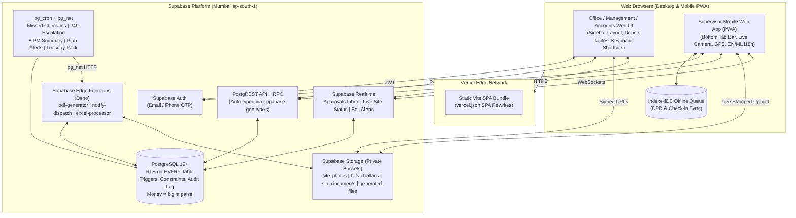

# Asty ERP — Architecture & Implementation Plan

> **Application Type:** Production Web Application (Responsive Desktop Web App for Office/Management/Accounts + Mobile-First Installable PWA Web App for Field Supervisors)
> **Repository:** https://github.com/thesnifmohd-hub/astyerp.git
> **Specification Source:** `docs/SPEC.md`

---

## 1. Overall Web Application Architecture

Asty ERP is a single unified **React 18 + Vite + TypeScript** web application deployed on **Vercel**, powered entirely by **Supabase** (`ap-south-1` Mumbai) with zero custom middleware servers.



### Core Technical Pillars
- **Frontend Stack:** React 18, Vite, TypeScript (strict), React Router v6, TanStack Query v5, React Hook Form + Zod, Tailwind CSS + `shadcn/ui`, `i18next` (`en` + `ml` Malayalam from day one), Leaflet + OpenStreetMap (site GPS boundary picker), Recharts (dashboards), `frappe-gantt` / `gantt-task-react` (Phase 2 schedule), SheetJS `xlsx` (Excel I/O), `@react-pdf/renderer` + Edge PDF (letterhead documents).
- **Adaptive Web Layout:** One codebase serving two responsive shells selected dynamically from user permissions and viewport:
  - **Office Shell:** Collapsible dark charcoal (`#1D2527`) sidebar, dense filterable data tables, keyboard navigation, multi-tab site & accounting workspaces.
  - **Field PWA Shell:** `vite-plugin-pwa` manifest + service worker, high-contrast touch cards (`min-h-12`), English/Malayalam toggle in header, live `getUserMedia` camera capture (`capture="environment"`, no gallery file picker) with HTML5 Canvas burn-in stamp (Date, IST Time, Lat/Lng, Accuracy, Site Name), Geolocation geofence check, and `IndexedDB` (`idb`) offline sync queue.
- **Regional & Monetary Standards:**
  - **Money:** Stored exclusively as `bigint` in **paise** (`₹1,00,000.00` = `10000000` paise). Zero floating-point math on currency.
  - **Formatting:** Indian numbering (`₹1,00,000`), dates `DD-MM-YYYY`, timezone `Asia/Kolkata` (IST), Financial Year `1 April – 31 March` (e.g., `FY 2026-27`).
  - **Brand System:** Asty Constructions — Deep Charcoal `#1D2527`, Muted Blue-Grey `#8DA1B1`, Jet Black `#0B0B0B`, Pure White `#FFFFFF`; headings in Neue Haas Grotesk / Inter, body in Manrope.

---

## 2. Full Supabase Database Schema (All 3 Phases)

Every business table includes `id uuid PRIMARY KEY DEFAULT gen_random_uuid()`, `created_at timestamptz DEFAULT now()`, `updated_at timestamptz DEFAULT now()`, Row Level Security (`ENABLE ROW LEVEL SECURITY` + `FORCE ROW LEVEL SECURITY`), and the universal `trg_audit_log` trigger. Financial and transactional rows **cannot be hard-deleted** (`status = 'cancelled'` or reversal voucher).

### 2.1 Entity-Relationship Diagram (Mermaid)

```mermaid
erDiagram
    PROFILES ||--o{ USER_POSITIONS : "holds"
    POSITIONS ||--o{ USER_POSITIONS : "assigned_to"
    POSITIONS ||--o| POSITIONS : "reports_to"
    POSITIONS ||--o{ POSITION_PERMISSIONS : "grants"
    PERMISSIONS ||--o{ POSITION_PERMISSIONS : "included_in"
    PROFILES ||--o{ USER_SITE_ACCESS : "scoped_to"

    CLIENTS ||--o{ SITES : "owns"
    SITES ||--|| SITE_FINANCIAL_TERMS : "secures_commercials"
    SITES ||--o{ SITE_ASSIGNMENTS : "staffed_by"
    SITES ||--o{ SITE_DOCUMENTS : "stores"
    SITES ||--|| COST_CENTRES : "maps_to"

    SITES ||--o{ DAILY_REPORTS : "logs_daily"
    DAILY_REPORTS ||--o{ DAILY_CHECKINS : "has_3_slots"
    DAILY_CHECKINS ||--o{ DAILY_PHOTOS : "captures_live"
    DAILY_REPORTS ||--o{ DAILY_ACTIVITY_LOGS : "tracks_work"
    DAILY_REPORTS ||--o{ DAILY_MATERIAL_USAGES : "consumes"
    DAILY_REPORTS ||--o{ DAILY_ISSUES : "flags_problems"

    APPROVAL_CHAINS ||--o{ APPROVAL_CHAIN_STEPS : "defines_steps"
    POSITIONS ||--o{ APPROVAL_CHAIN_STEPS : "acts_on"
    SITES ||--o{ APPROVAL_REQUESTS : "raises"
    APPROVAL_REQUESTS ||--o{ APPROVAL_ACTIONS : "records_history"

    ITEMS ||--o{ VENDOR_ITEM_RATES : "priced_at"
    VENDORS ||--o{ VENDOR_ITEM_RATES : "quotes"
    SITES ||--o{ MATERIAL_REQUESTS : "requests"
    MATERIAL_REQUESTS ||--o{ MATERIAL_REQUEST_LINES : "contains"
    MATERIAL_REQUESTS ||--o{ PURCHASE_ORDERS : "converts_to"
    VENDORS ||--o{ PURCHASE_ORDERS : "supplies"
    PURCHASE_ORDERS ||--o{ PURCHASE_ORDER_LINES : "orders"
    PURCHASE_ORDERS ||--o{ GOODS_RECEIPTS : "fulfilled_by"
    GOODS_RECEIPTS ||--o{ GOODS_RECEIPT_LINES : "receives"
    SITES ||--o{ SITE_STOCK_LEDGER : "tracks_inventory"
    ITEMS ||--o{ SITE_STOCK_LEDGER : "moves"

    SITES ||--o{ BOQ_VERSIONS : "estimates"
    BOQ_VERSIONS ||--|| SITE_RATE_SHEETS : "uses_rates"
    BOQ_VERSIONS ||--o{ BOQ_ITEMS : "breaks_down"
    BOQ_VERSIONS ||--o{ QUOTATIONS : "generates"
    BOQ_VERSIONS ||--o{ SITE_PLANS : "baselines"
    SITE_PLANS ||--o{ PLAN_ACTIVITIES : "schedules"
    PLAN_ACTIVITIES ||--o{ PLAN_DEPENDENCIES : "precedes"
    PLAN_ACTIVITIES ||--o{ ACTIVITY_MATERIAL_SCHEDULES : "needs_material"
    PLAN_ACTIVITIES ||--o{ ACTIVITY_DRAWING_SCHEDULES : "needs_drawing"

    CREWS ||--o{ WORKERS : "groups"
    WORKERS ||--o{ WORKER_ATTENDANCE : "attends"
    WORKERS ||--o{ WAGE_SHEET_LINES : "paid_in"
    WAGE_SHEETS ||--o{ WAGE_SHEET_LINES : "summarises"

    SUBCONTRACTORS ||--o{ WORK_ORDERS : "contracted_via"
    WORK_ORDERS ||--o{ SUBCONTRACTOR_BILLS : "billed_against"

    ACCOUNT_GROUPS ||--o{ LEDGER_ACCOUNTS : "classifies"
    VOUCHERS ||--o{ VOUCHER_LINES : "balances_dr_cr"
    LEDGER_ACCOUNTS ||--o{ VOUCHER_LINES : "posts_to"
    COST_CENTRES ||--o{ VOUCHER_LINES : "tags_site"
    SITES ||--o{ CLIENT_BILLS : "invoices"
    CLIENT_BILLS ||--o{ CLIENT_BILL_LINES : "itemises"
    CLIENT_BILLS ||--o{ CLIENT_RECEIPT_ALLOCATIONS : "settles"
```



---

### 2.2 Phase 1 Tables — Identity, RBAC, Sites, DPR, Approvals, Basic Materials, Notifications

| Domain | Table | Key Columns & Types | Relations & Notes |
|---|---|---|---|
| **Settings** | `company_settings` | `id`, `company_name`, `gstin`, `pan`, `cin`, `registered_address`, `letterhead_logo_path`, `default_geofence_radius_m` (150), `anti_split_days` (7), `escalation_hours` (24), `fy_start_month` (4) | Singleton configuration row |
| **Settings** | `number_series` | `id`, `doc_type` (`MR`, `PO`, `GRN`, `APR`, `VCH_PMT`, `INV`, etc.), `financial_year` (`2026-27`), `prefix`, `current_number` int | Atomic numbering via `SELECT ... FOR UPDATE` |
| **Auth / RBAC** | `profiles` | `id` (PK, FK `auth.users`), `employee_code`, `full_name`, `email`, `phone`, `preferred_language` (`en`\|`ml`), `is_active` bool, `deactivated_at` | Never hard-deleted so historical audit logs stay intact |
| **Auth / RBAC** | `positions` | `id`, `name` UNIQUE, `login_type` (`admin`\|`management`\|`office`\|`field`\|`external`), `device_hint`, `description`, `reports_to_position_id` (self FK), `is_system_protected` bool, `is_active` bool | `System Admin` has `is_system_protected = true` (cannot be deleted/deactivated) |
| **Auth / RBAC** | `permissions` | `id`, `code` UNIQUE (e.g. `site.view`, `voucher.post`, `report.profit.view`), `module`, `action` (`view`\|`create`\|`edit`\|`approve`\|`delete`\|`export`), `description` | Master permission catalog |
| **Auth / RBAC** | `position_permissions` | `position_id` FK, `permission_id` FK | Composite PK; drives Admin Permission Matrix |
| **Auth / RBAC** | `user_positions` | `id`, `user_id` FK `profiles`, `position_id` FK `positions`, `is_primary` bool, `is_active` bool | Many-to-many (a user can hold multiple positions; multiple users can share a position) |
| **Auth / RBAC** | `user_site_access` | `id`, `user_id` FK `profiles`, `all_sites` bool DEFAULT false, `site_id` FK `sites` nullable | Grants explicit site visibility or company-wide site access |
| **Audit** | `audit_log` | `id`, `table_name`, `record_id` uuid, `operation` (`INSERT`\|`UPDATE`\|`DELETE`), `actor_user_id` uuid, `actor_position_ids` uuid[], `old_values` jsonb, `new_values` jsonb, `created_at` | Append-only; `UPDATE`/`DELETE` revoked on `audit_log` |
| **Sites** | `clients` | `id`, `code`, `name`, `phone`, `email`, `gstin`, `pan`, `billing_address`, `portal_user_id` FK `profiles` nullable, `is_active` | Client master |
| **Sites** | `sites` | `id`, `code` UNIQUE, `name`, `client_id` FK, `site_address`, `lat` numeric(10,7), `lng` numeric(10,7), `geofence_radius_m` int DEFAULT 150, `project_type` (`residential`\|`commercial`), `contract_type` (`lump_sum`\|`item_rate`\|`labour_only`\|`pmc_percent`\|`cost_plus`), `status` (`planning`\|`active`\|`on_hold`\|`completed`\|`cancelled`), `start_date`, `target_end_date`, `morning_start` time (`08:00`), `morning_end` time (`10:00`), `afternoon_start` time (`12:30`), `afternoon_end` time (`14:30`), `evening_start` time (`16:30`), `evening_end` time (`19:00`), `schedule_health` (`on_track`\|`at_risk`\|`delayed`), `days_behind` int DEFAULT 0 | Visible via `can_access_site(auth.uid(), id)`. Commercial amounts are isolated in `site_financial_terms` so non-permitted users never see contract values |
| **Sites** | `site_financial_terms` | `site_id` PK FK `sites`, `contract_value_paise` bigint, `pmc_fee_pct` numeric(5,2), `retention_pct` numeric(5,2), `mobilisation_advance_paise` bigint, `profit_share_split` jsonb (e.g. `[{"label":"Partner A","pct":50},{"label":"Partner B","pct":50}]` or referral split) | Strictly gated by `has_permission(auth.uid(), 'report.profit.view')` |
| **Sites** | `site_assignments` | `id`, `site_id` FK, `user_id` FK, `position_id` FK, `is_active` bool, `assigned_from` date, `assigned_to` date | Tracks assigned Site Supervisors & Project Coordinator |
| **Sites** | `site_documents` | `id`, `site_id` FK, `category` (`drawing`\|`agreement`\|`permit`\|`boq`\|`other`), `title`, `version`, `storage_path`, `uploaded_by` FK | Stored in private `site-documents` bucket |
| **DPR** | `daily_reports` | `id`, `site_id` FK, `report_date` date, `status` (`open`\|`morning_done`\|`afternoon_done`\|`closed`), `tomorrow_plan` text, `closed_at` timestamptz, `closed_by` FK | `UNIQUE (site_id, report_date)` |
| **DPR** | `daily_checkins` | `id`, `daily_report_id` FK, `site_id` FK, `slot` (`morning`\|`afternoon`\|`evening`), `checked_in_by` FK, `captured_at` timestamptz, `synced_at` timestamptz, `lat` numeric(10,7), `lng` numeric(10,7), `accuracy_m` numeric(8,2), `distance_from_site_m` numeric(8,2), `is_within_window` bool, `is_low_accuracy` bool, `is_mock_flagged` bool, `offline_submission_id` uuid UNIQUE, `payload_json` jsonb | `UNIQUE (daily_report_id, slot)`; `offline_submission_id` guarantees idempotent background sync |
| **DPR** | `daily_photos` | `id`, `daily_checkin_id` FK, `site_id` FK, `slot`, `storage_path`, `captured_at` timestamptz, `lat` numeric(10,7), `lng` numeric(10,7), `accuracy_m` numeric(8,2), `caption` text | Afternoon & Evening each enforce `>= 3` photos |
| **DPR** | `daily_subcontractor_counts` | `id`, `daily_report_id` FK, `trade`, `subcontractor_id` FK nullable, `headcount` int | Morning check-in subcontractor trade counts |
| **DPR** | `daily_activity_logs` | `id`, `daily_report_id` FK, `plan_activity_id` FK nullable, `activity_title`, `selected_in_morning` bool, `completed_qty` numeric(14,3), `unit`, `completed_pct` numeric(5,2), `notes` | Links Phase 1 DPR cleanly to Phase 2 `plan_activities` |
| **DPR** | `daily_material_usages` | `id`, `daily_report_id` FK, `site_id` FK, `item_id` FK, `qty_used` numeric(14,3), `plan_activity_id` FK nullable, `notes` | Evening submission triggers automatic stock deduction |
| **DPR** | `daily_issues` | `id`, `daily_report_id` FK, `site_id` FK, `category` (`material`\|`drawing`\|`labour`\|`weather`\|`client`\|`equipment`\|`other`), `description`, `is_urgent` bool, `status` (`open`\|`resolved`), `resolved_at`, `resolved_by` | `is_urgent = true` triggers instant alert to Management |
| **Approvals** | `approval_chains` | `id`, `request_type` UNIQUE (`material_request`\|`purchase_order`\|`petty_cash`\|`subcontractor_bill`\|`task_completion`\|`extra_work`\|`plan_change`\|`client_bill`), `name`, `anti_split_enabled` bool, `anti_split_window_days` int DEFAULT 7, `escalation_hours` int DEFAULT 24, `is_active` bool | Configurable per request type in Admin screen |
| **Approvals** | `approval_chain_steps` | `id`, `chain_id` FK, `step_order` int, `position_id` FK `positions`, `step_kind` (`technical_check`\|`review`\|`approve`), `min_amount_paise` bigint nullable, `max_amount_paise` bigint nullable, `always_required` bool DEFAULT false | Default spend rule: Step 1 Project Coordinator (`technical_check`), Step 2 Operations Executive (`approve` if `<= 300000` paise else `review`), Step 3 Management (`approve` if `> 300000` paise) |
| **Approvals** | `approval_requests` | `id`, `request_number` UNIQUE, `request_type`, `site_id` FK nullable, `source_table`, `source_id` uuid, `anti_split_item_id` FK `items` nullable, `amount_paise` bigint DEFAULT 0, `rolling_7d_amount_paise` bigint DEFAULT 0, `status` (`pending`\|`sent_back`\|`approved`\|`rejected`\|`cancelled`), `current_step_order` int, `current_position_id` FK `positions`, `requested_by` FK, `submitted_at` timestamptz, `step_started_at` timestamptz, `escalation_level` int DEFAULT 0, `resolved_at` timestamptz, `metadata` jsonb | Central inbox table; Realtime-enabled |
| **Approvals** | `approval_actions` | `id`, `request_id` FK, `step_order` int, `action` (`submit`\|`technical_ok`\|`review_ok`\|`approve`\|`reject`\|`send_back`\|`escalate`\|`cancel`), `actor_user_id` FK, `actor_position_id` FK, `comment` text, `created_at` | Immutable approval audit trail |
| **Approvals** | `approval_attachments` | `id`, `request_id` FK, `attachment_kind`, `storage_path`, `uploaded_by` FK | Required attachments per SPEC 4.5 |
| **Materials** | `items` | `id`, `code` UNIQUE, `name`, `name_ml` text, `category`, `unit` (`bag`\|`cft`\|`m3`\|`kg`\|`ton`\|`nos`\|`sqft`\|`m2`\|`ltr`), `hsn_code`, `gst_rate_pct` numeric(5,2), `default_wastage_pct` numeric(5,2), `is_active` | Item master |
| **Materials** | `vendors` | `id`, `code` UNIQUE, `name`, `contact_name`, `phone`, `email`, `gstin`, `pan`, `address`, `bank_details` jsonb, `ledger_account_id` uuid nullable, `is_active` | Vendor master |
| **Materials** | `vendor_item_rates` | `id`, `vendor_id` FK, `item_id` FK, `rate_paise` bigint, `effective_date` date | Reference rate list |
| **Materials** | `material_requests` | `id`, `mr_number` UNIQUE, `site_id` FK, `requested_by` FK, `needed_by_date` date, `plan_activity_id` uuid nullable, `status` (`draft`\|`pending_approval`\|`sent_back`\|`approved`\|`po_issued`\|`fulfilled`\|`rejected`\|`cancelled`), `approval_request_id` FK, `remarks` | Linked to `material_request_lines` (`item_id`, `qty`, `est_rate_paise`) |
| **Materials** | `purchase_orders` | `id`, `po_number` UNIQUE, `site_id` FK, `vendor_id` FK, `material_request_id` FK nullable, `po_date` date, `delivery_date` date, `subtotal_paise` bigint, `cgst_paise` bigint, `sgst_paise` bigint, `igst_paise` bigint, `total_paise` bigint, `status` (`draft`\|`pending_approval`\|`approved`\|`sent_to_vendor`\|`part_received`\|`received`\|`cancelled`), `approval_request_id` FK, `pdf_storage_path`, `terms` | Linked to `purchase_order_lines` (`item_id`, `qty_ordered`, `qty_received`, `rate_paise`, `gst_rate_pct`, `amount_paise`, `last_3_rates_json`) |
| **Materials** | `goods_receipts` | `id`, `grn_number` UNIQUE, `site_id` FK, `purchase_order_id` FK nullable, `vendor_id` FK, `received_by` FK, `received_at` timestamptz, `challan_no`, `challan_photo_path` (NOT NULL), `vehicle_no`, `daily_report_id` FK nullable, `status` (`confirmed`\|`cancelled`) | Linked to `goods_receipt_lines` (`po_line_id`, `item_id`, `qty_received`, `qty_accepted`); updates `site_stock_ledger` |
| **Alerts** | `notification_rules` | `id`, `event_code` UNIQUE, `description`, `recipient_position_ids` uuid[], `channels` text[], `is_active` bool | Addressed to **positions**, never individuals |
| **Alerts** | `notifications` | `id`, `user_id` FK, `position_id` FK, `site_id` FK nullable, `event_code`, `title_key`, `body_key`, `params` jsonb, `priority` (`normal`\|`high`\|`urgent`), `is_read` bool DEFAULT false, `read_at`, `created_at` | Realtime bell + Web Push |
| **Alerts** | `push_subscriptions` | `id`, `user_id` FK, `endpoint` UNIQUE, `p256dh`, `auth`, `device_label`, `is_active` | Browser Web Push subscriptions |

---

### 2.3 Phase 2 Tables — BOQ, Quotation, Site Planning & Gantt, Stock Transfers, Own Labour, Subcontractors

| Domain | Table | Key Columns & Types | Relations & Notes |
|---|---|---|---|
| **BOQ** | `master_rate_sheets` | `id`, `name`, `project_type` (`residential`\|`commercial`), `floor_height_min_m`, `floor_height_max_m`, `default_concrete_grade`, `wastage_pct`, `profit_pct`, `rates_payload` jsonb (cement/bag, M-sand/cft, 20mm/40mm agg/cft, steel/kg, binding wire, RMC M25/M30/M35, mason ₹1,500, helper ₹1,200, carpenter, bar bender, shuttering/staging/mixer/vibrator rent, labour outputs/day), `is_active` | Company master templates |
| **BOQ** | `boq_versions` | `id`, `site_id` FK, `version_no` int (`v1`, `v2`…), `project_type`, `built_up_area_sqft` numeric(12,2), `status` (`draft`\|`approved_locked`\|`superseded`), `is_locked` bool, `total_estimated_cost_paise` bigint, `profit_pct` numeric(5,2), `quoted_total_paise` bigint, `rounded_total_paise` bigint, `approved_by` FK, `approved_at` | `UNIQUE(site_id, version_no)`; locked upon approval |
| **BOQ** | `site_rate_sheets` | `id`, `boq_version_id` UNIQUE FK, `copied_from_master_id` FK, `rates_payload` jsonb, `wastage_pct`, `profit_pct`, `floor_height_m` | Per-project editable copy until BOQ version is locked |
| **BOQ** | `boq_items` | `id`, `boq_version_id` FK, `sort_order` int, `stage_name`, `work_type` (`footing`\|`neck_column`\|`column`\|`plinth_beam`\|`beam`\|`slab`\|`stair`\|`wall`\|`retaining_wall`\|`water_tank`\|`laterite_masonry`\|`lintel`\|`sunshade`\|`parapet`\|`window_fixing`\|`pcc_flooring`\|`sloped_roof`\|`custom`), `concrete_grade`, `concrete_m3`, `formwork_m2`, `steel_kg`, `staging_m2`, `masonry_nos`, `pour_days` numeric(6,2), `material_cost_paise` bigint, `labour_cost_paise` bigint, `formwork_cost_paise` bigint, `rent_cost_paise` bigint, `steel_cost_paise` bigint, `total_cost_paise` bigint, `quoted_rate_paise` bigint, `quoted_amount_paise` bigint | Automatic cost & material purchase rollup (`boq_material_totals` view/table) |
| **BOQ** | `quotations` | `id`, `quotation_no` UNIQUE, `site_id` FK, `boq_version_id` FK, `print_format` (`commercial_11_col`\|`residential_full_boq`\|`residential_per_sqft`), `rate_per_sqft_paise` bigint nullable, `terms_text`, `pdf_path`, `excel_path`, `created_at` | Generates Asty letterhead PDF + Excel |
| **Planning** | `site_plans` | `id`, `site_id` FK, `boq_version_id` FK, `version_no` int, `is_baseline` bool, `status` (`draft`\|`pending_approval`\|`active`\|`superseded`), `change_reason` text, `approval_request_id` FK, `approved_by` FK, `approved_at` | First Management-approved plan is saved as baseline; revisions preserve baseline dates |
| **Planning** | `plan_activities` | `id`, `site_plan_id` FK, `site_id` FK, `boq_item_id` FK nullable, `code`, `name`, `quantity` numeric(14,3), `unit`, `daily_output_norm` numeric(12,3), `suggested_duration_days` int, `duration_days` int, `baseline_start` date, `baseline_end` date, `planned_start` date, `planned_end` date, `actual_start` date, `actual_end` date, `completed_qty` numeric(14,3) DEFAULT 0, `progress_pct` numeric(5,2) DEFAULT 0, `crew_assignment_type` (`own_concrete`\|`own_brick`\|`subcontractor`), `crew_id` FK nullable, `subcontractor_id` FK nullable, `quality_checked_by` FK nullable, `status` | Connected directly to Evening DPR quantities & Task Completion approvals |
| **Planning** | `plan_dependencies` | `id`, `site_plan_id` FK, `predecessor_id` FK `plan_activities`, `successor_id` FK `plan_activities`, `dep_type` DEFAULT `'FS'`, `lag_days` int DEFAULT 0 | Finish-to-Start Gantt links (cycle detection in trigger) |
| **Planning** | `activity_material_schedules` | `id`, `plan_activity_id` FK, `site_id` FK, `item_id` FK, `required_qty` numeric(14,3), `needed_on_site_by` date, `material_request_id` FK nullable, `purchase_order_id` FK nullable | Drives "Material needed in N days — not ordered" alert |
| **Planning** | `activity_drawing_schedules` | `id`, `plan_activity_id` FK, `site_id` FK, `drawing_name`, `external_consultant_name`, `consultant_contact`, `due_date` date, `received_date` date nullable, `site_document_id` FK nullable, `status` (`pending`\|`received`\|`overdue`) | Tracks outside architects/structural engineers |
| **Inventory** | `site_stock_ledger` | `id`, `site_id` FK, `item_id` FK, `txn_type` (`grn_in`\|`usage_out`\|`transfer_out`\|`transfer_in`\|`opening`\|`adjustment`), `qty_signed` numeric(14,3), `source_table`, `source_id` uuid, `txn_at` timestamptz | Paired with `site_stock_balances (site_id, item_id, qty_on_hand)` |
| **Inventory** | `stock_transfers` | `id`, `transfer_no` UNIQUE, `from_site_id` FK, `to_site_id` FK, `requested_by` FK, `approved_by_coordinator` FK, `received_by_supervisor` FK, `status` (`pending_coordinator`\|`in_transit`\|`received`\|`cancelled`), `dispatch_photo_path`, `receipt_photo_path` | Linked to `stock_transfer_lines` |
| **Labour** | `crews` | `id`, `name`, `crew_type` (`own_concrete`\|`own_brick`), `is_active` bool | Used for multi-site crew calendar & clash detection |
| **Labour** | `workers` | `id`, `worker_code` UNIQUE, `full_name`, `phone`, `trade` (`concrete_worker`\|`brick_worker`\|`mason`\|`helper`\|`carpenter`\|`bar_bender`), `crew_id` FK nullable, `daily_wage_paise` bigint, `joining_date` date, `advance_balance_paise` bigint DEFAULT 0, `is_active` bool | Own worker master |
| **Labour** | `worker_attendance` | `id`, `worker_id` FK, `site_id` FK, `attendance_date` date, `daily_report_id` FK nullable, `attendance_status` (`present`\|`half_day`\|`absent`), `multiplier` numeric(3,2) (`1.0`\|`0.5`\|`0.0`), `earned_paise` bigint | Populated directly from Morning Check-in |
| **Labour** | `worker_advances` | `id`, `worker_id` FK, `site_id` FK nullable, `txn_date` date, `direction` (`given`\|`recovered`), `amount_paise` bigint, `wage_sheet_id` FK nullable, `voucher_id` uuid nullable, `remarks` | Maintains `workers.advance_balance_paise` via trigger |
| **Labour** | `wage_sheets` | `id`, `wage_sheet_no` UNIQUE, `week_start` date, `week_end` date, `site_id` FK nullable, `gross_paise` bigint, `advance_recovery_paise` bigint, `other_deduction_paise` bigint, `net_payable_paise` bigint, `status` (`draft`\|`approved`\|`pending_posting`\|`posted`\|`paid`\|`cancelled`), `voucher_id` uuid nullable | Linked to `wage_sheet_lines` |
| **Subcon** | `subcontractors` | `id`, `code` UNIQUE, `name`, `trade`, `phone`, `pan`, `gstin`, `tds_section` DEFAULT `'194C'`, `tds_rate_pct` numeric(5,2) (`1.00` individual/HUF, `2.00` others), `bank_details` jsonb, `ledger_account_id` uuid nullable, `is_active` | Subcontractor master |
| **Subcon** | `work_orders` | `id`, `wo_no` UNIQUE, `site_id` FK, `subcontractor_id` FK, `scope`, `start_date`, `end_date`, `retention_pct` numeric(5,2), `total_paise` bigint, `status` (`draft`\|`approved`\|`active`\|`closed`\|`cancelled`) | Linked to `work_order_lines` (`boq_item_id`, `qty`, `rate_paise`, `amount_paise`) |
| **Subcon** | `subcontractor_bills` | `id`, `bill_no` UNIQUE, `work_order_id` FK, `site_id` FK, `subcontractor_id` FK, `bill_date` date, `gross_paise` bigint, `cgst_paise` bigint, `sgst_paise` bigint, `igst_paise` bigint, `retention_paise` bigint, `tds_194c_paise` bigint, `net_payable_paise` bigint, `status` (`draft`\|`pending_approval`\|`approved`\|`pending_posting`\|`posted`\|`paid`\|`cancelled`), `approval_request_id` FK, `voucher_id` uuid nullable | Linked to `subcontractor_bill_lines` (`prev_qty`, `this_qty`, `cum_qty`) |

---

### 2.4 Phase 3 Tables — Double-Entry Accounting, Petty Cash, Bank Reco, GST/TDS, Fixed Assets, Loans, Client Billing

| Domain | Table | Key Columns & Types | Relations & Notes |
|---|---|---|---|
| **Accounts** | `account_groups` | `id`, `code`, `name`, `nature` (`assets`\|`liabilities`\|`income`\|`expenses`\|`equity`), `parent_id` self FK, `is_direct` bool, `is_system` bool | Seeded with Indian standard groups (Capital, Loans, Current Liabilities, Fixed Assets, Current Assets, Sundry Debtors, Sundry Creditors, Bank, Cash, Direct/Indirect Income & Expenses, Duties & Taxes) |
| **Accounts** | `ledger_accounts` | `id`, `code` UNIQUE, `name`, `group_id` FK, `gstin`, `pan`, `default_tds_section`, `opening_balance_paise` bigint DEFAULT 0, `opening_dr_cr` (`DR`\|`CR`), `linked_type` (`vendor`\|`subcontractor`\|`client`\|`bank`\|`petty_cash`\|`tax`\|null), `linked_id` uuid nullable, `is_active` bool | Editable Chart of Accounts |
| **Accounts** | `cost_centres` | `id`, `code` UNIQUE, `name`, `site_id` UNIQUE FK nullable, `is_head_office` bool DEFAULT false, `is_active` bool | Auto-created trigger when a `site` is inserted, plus `HO` Head Office |
| **Accounts** | `financial_periods` | `id`, `financial_year` (`2026-27`), `period_start` date, `period_end` date, `is_year_closed` bool, `is_locked` bool DEFAULT false, `locked_by` FK, `locked_at`, `mgmt_unlock_override_until` timestamptz nullable | Blocks edits in locked months/years |
| **Accounts** | `vouchers` | `id`, `voucher_no`, `financial_year`, `voucher_type` (`payment`\|`receipt`\|`contra`\|`journal`\|`purchase`\|`sales`\|`debit_note`\|`credit_note`), `voucher_date` date, `status` (`draft`\|`pending_posting`\|`posted`\|`cancelled`\|`reversed`), `source_type` nullable, `source_id` uuid nullable, `narration` text, `total_dr_paise` bigint, `total_cr_paise` bigint, `is_rcm` bool DEFAULT false, `prepared_by` FK, `reviewed_by` FK, `posted_by` FK, `posted_at` timestamptz, `reversal_voucher_id` self FK nullable | `UNIQUE(financial_year, voucher_type, voucher_no)`; deferred constraint trigger guarantees `SUM(DR) = SUM(CR)` |
| **Accounts** | `voucher_lines` | `id`, `voucher_id` FK, `line_no` int, `ledger_account_id` FK, `cost_centre_id` FK, `dr_cr` (`DR`\|`CR`), `amount_paise` bigint CHECK (`amount_paise > 0`), `hsn_sac`, `gst_rate_pct`, `taxable_paise` bigint, `payment_mode` (`cash`\|`cheque`\|`upi`\|`neft`\|`rtgs`), `instrument_no`, `instrument_date`, `line_note` | Every P&L line carries `cost_centre_id` (Site or Head Office) |
| **Purchases** | `purchase_bills` | `id`, `bill_no` UNIQUE, `site_id` FK, `vendor_id` FK, `purchase_order_id` FK nullable, `goods_receipt_id` FK nullable, `supplier_inv_no`, `supplier_inv_date` date, `taxable_paise` bigint, `cgst_paise` bigint, `sgst_paise` bigint, `igst_paise` bigint, `is_reverse_charge` bool, `tds_section`, `tds_paise` bigint, `total_paise` bigint, `status` (`draft`\|`pending_posting`\|`posted`\|`cancelled`), `voucher_id` FK nullable | Feeds GSTR-3B ITC & Pending Posting queue |
| **Petty Cash** | `petty_cash_wallets` | `id`, `site_id` FK, `supervisor_user_id` FK, `ledger_account_id` FK, `balance_paise` bigint DEFAULT 0, `imprest_limit_paise` bigint | Per site/supervisor petty cash wallet |
| **Petty Cash** | `petty_cash_entries` | `id`, `wallet_id` FK, `site_id` FK, `entry_type` (`issue`\|`spend`\|`settlement`), `entry_date` date, `amount_paise` bigint, `purpose` text, `bill_photo_path` text, `approval_request_id` FK nullable, `status` (`draft`\|`pending_approval`\|`approved`\|`pending_posting`\|`posted`\|`cancelled`), `voucher_id` FK nullable | Trigger blocks `settlement` without `bill_photo_path` |
| **Banking** | `bank_accounts` | `id`, `ledger_account_id` UNIQUE FK, `bank_name`, `branch`, `account_no`, `ifsc`, `upi_id`, `is_active` | Multiple company bank accounts |
| **Banking** | `bank_statement_lines` | `id`, `bank_account_id` FK, `import_batch_id` uuid, `value_date` date, `description`, `utr_cheque_ref`, `withdrawal_paise` bigint, `deposit_paise` bigint, `balance_paise` bigint, `matched_voucher_line_id` FK nullable, `reconciled_at` timestamptz, `reconciled_by` FK | Excel/CSV bank reconciliation |
| **Tax** | `tds_entries` | `id`, `voucher_id` FK, `deductee_ledger_id` FK, `pan`, `section` (`194C`\|`194J`), `base_amount_paise` bigint, `tds_rate_pct` numeric(5,2), `tds_amount_paise` bigint, `challan_paid_voucher_id` FK nullable, `quarter` text | 194C & 194J register and payable report |
| **Assets/Loans**| `fixed_assets` | `id`, `asset_code` UNIQUE, `name`, `category` (`goods_vehicle`\|`plant_machinery`\|`office_equipment`\|`furniture`\|`computer`), `wdv_rate_pct` numeric(5,2) (e.g. `40.00`), `purchase_date` date, `put_to_use_date` date, `addition_cost_paise` bigint, `opening_wdv_paise` bigint, `Status` | Linked to `fixed_asset_depreciation_runs` (IT Act >180 / <180 days rule) |
| **Assets/Loans**| `loans` | `id`, `loan_no` UNIQUE, `lender`, `ledger_account_id` FK, `linked_asset_id` FK nullable, `principal_paise` bigint, `annual_interest_pct` numeric(5,2), `tenure_months` int, `first_emi_date` date | Linked to `loan_emi_schedules` (`emi_no`, `due_date`, `emi_paise`, `principal_paise`, `interest_paise`, `voucher_id`) |
| **Billing** | `extra_work_requests` | `id`, `ewo_no` UNIQUE, `site_id` FK, `description`, `estimate_paise` bigint, `client_approval_method` (`upload`\|`otp`), `client_proof_path`, `client_approved_at` timestamptz, `approval_request_id` FK, `status` | Must have client approval before work starts & before Extra Work Bill |
| **Billing** | `client_bills` | `id`, `invoice_no` UNIQUE, `financial_year`, `site_id` FK, `client_id` FK, `bill_type` (`ra_bill`\|`final_bill`\|`labour_bill`\|`extra_work_bill`\|`pmc_fee_bill`), `ra_bill_seq` int nullable, `invoice_date` date, `due_date` date, `place_of_supply`, `hsn_sac_code`, `cumulative_work_paise` bigint, `prev_certified_paise` bigint, `this_bill_gross_paise` bigint, `retention_held_paise` bigint, `advance_recovery_paise` bigint, `taxable_paise` bigint, `cgst_paise` bigint, `sgst_paise` bigint, `igst_paise` bigint, `total_invoice_paise` bigint, `received_paise` bigint DEFAULT 0, `status` (`draft`\|`ops_checked`\|`pending_mgmt_approval`\|`approved`\|`posted`\|`part_paid`\|`paid`\|`cancelled`), `approval_request_id` FK, `voucher_id` FK nullable, `pdf_path` | Linked to `client_bill_lines` & `client_receipt_allocations` |
| **Imports** | `smart_build_import_batches` | `id`, `imported_by` FK, `file_path`, `import_kind` (`opening_ledgers`\|`open_receivables`\|`open_payables`), `row_count` int, `total_dr_paise` bigint, `total_cr_paise` bigint, `status` | Auditable migration from Smart Build |
| **Reports** | `tuesday_meeting_packs` | `id`, `meeting_date` date UNIQUE, `snapshot_json` jsonb, `pdf_storage_path`, `excel_storage_path`, `generated_at` timestamptz | Generated every Tuesday 7:00 AM IST |

---

## 3. Configurable Positions + Permissions Model & RLS Architecture

Per `SPEC.md` Section 3, **zero role names or person names ever appear in TypeScript, SQL functions, or RLS policies**.

### 3.1 How Authorization Works
1. **Granular Permission Codes (`permissions.code`):**
   - `admin.users.view/create/edit`, `admin.positions.view/create/edit`, `admin.settings.edit`, `admin.approvals.edit`
   - `site.view`, `site.create`, `site.edit`, `site.documents.manage`
   - `dpr.checkin`, `dpr.view`, `dpr.export`
   - `approval.raise`, `approval.technical_check`, `approval.review`, `approval.approve`
   - `material.item.manage`, `material.vendor.manage`, `material.mr.view/create`, `material.po.view/create/export`, `material.grn.view/create`, `material.transfer.approve`
   - `boq.view/create/edit/approve/export`, `plan.view/create/edit/approve`
   - `labour.worker.manage`, `labour.attendance.record`, `labour.wages.prepare/approve`
   - `subcon.manage`, `subcon.wo.manage`, `subcon.bill.create/approve`
   - `voucher.view`, `voucher.draft`, `voucher.post`, `period.lock`, `period.unlock_override`, `bank.reconcile`, `tax.gst_tds.view/export`, `asset.manage`
   - `client_bill.view/create/ops_check/approve`, `client_portal.view`, `client_portal.approve_extra`
   - `report.operations.view`, `report.accounts.view`, `report.profit.view` *(controls visibility of `site_financial_terms`, BOQ margins, Site-wise P&L profit, and Partner Profit-Share statements)*

2. **Core Security-Definer SQL Helpers (Indexed & `STABLE`):**
   ```sql
   CREATE OR REPLACE FUNCTION public.has_permission(p_user_id uuid, p_perm_code text)
   RETURNS boolean
   LANGUAGE sql
   STABLE
   SECURITY DEFINER
   SET search_path = public
   AS $$
     SELECT EXISTS (
       SELECT 1
       FROM public.profiles pr
       JOIN public.user_positions up ON up.user_id = pr.id AND up.is_active = true
       JOIN public.positions pos ON pos.id = up.position_id AND pos.is_active = true
       JOIN public.position_permissions pp ON pp.position_id = pos.id
       JOIN public.permissions perm ON perm.id = pp.permission_id
       WHERE pr.id = p_user_id
         AND pr.is_active = true
         AND perm.code = p_perm_code
     );
   $$;

   CREATE OR REPLACE FUNCTION public.can_access_site(p_user_id uuid, p_site_id uuid)
   RETURNS boolean
   LANGUAGE sql
   STABLE
   SECURITY DEFINER
   SET search_path = public
   AS $$
     SELECT EXISTS (
       SELECT 1
       FROM public.profiles pr
       WHERE pr.id = p_user_id
         AND pr.is_active = true
         AND (
           EXISTS (
             SELECT 1 FROM public.user_site_access usa
             WHERE usa.user_id = p_user_id
               AND (usa.all_sites = true OR usa.site_id = p_site_id)
           )
           OR EXISTS (
             SELECT 1 FROM public.site_assignments sa
             WHERE sa.user_id = p_user_id
               AND sa.site_id = p_site_id
               AND sa.is_active = true
           )
         )
     );
   $$;
   ```

3. **RLS Policy Pattern on Every Table:**
   - **Site-scoped operational tables** (`sites`, `daily_reports`, `material_requests`, `plan_activities`, etc.):
     - `SELECT`: `has_permission(auth.uid(), '<module>.view') AND can_access_site(auth.uid(), site_id)`
     - `INSERT` / `UPDATE`: `has_permission(auth.uid(), '<module>.create|edit') AND can_access_site(auth.uid(), site_id)`
   - **Sensitive commercial & profit tables** (`site_financial_terms`, partner split views):
     - `SELECT`: `has_permission(auth.uid(), 'report.profit.view') AND can_access_site(auth.uid(), site_id)`
     - Because `site_financial_terms` is a separate table from `sites`, a Site Supervisor or Junior Accountant querying `sites` via the Supabase client or raw REST API physically cannot read `contract_value_paise` or `profit_share_split`.
   - **Accounting Posting Isolation:**
     - `vouchers`: Junior Accountant (`voucher.draft`) can `INSERT`/`UPDATE` rows only where `status IN ('draft', 'pending_posting')` and period is unlocked. Transitioning `status -> 'posted'` is restricted by both RLS `WITH CHECK` and a `BEFORE UPDATE` trigger requiring `has_permission(auth.uid(), 'voucher.post')`.
   - **Zero-Code Extensibility:** Adding `"Site Engineer"` or `"Store Keeper"` later in Admin inserts a row in `positions`, ticks rows in `position_permissions`, sets `reports_to_position_id`, and optionally inserts into `approval_chain_steps` — RLS, menus, notifications, and approvals immediately honor it with zero code deploys.

---

## 4. Business Logic Placement (Postgres vs. Edge Functions vs. `pg_cron`)

### 4.1 PostgreSQL Functions, RPCs & Triggers (Transactional Source of Truth)
- **`fn_audit_trigger()`:** Attached to all business tables; writes `actor_user_id`, active `position_ids`, `old_values`, and `new_values` to `audit_log`.
- **Financial Immutability Trigger:** Blocks `DELETE` on financial/approval/DPR tables; blocks `UPDATE` on `posted` vouchers, `locked` financial periods (unless Management unlock window is active), and `approved_locked` BOQ versions.
- **`rpc_submit_checkin()`:**
  - Computes exact Haversine distance in meters between `(lat, lng)` and `(sites.lat, sites.lng)`; rejects check-in if `distance > sites.geofence_radius_m`.
  - Flags `is_low_accuracy = (accuracy_m > 50)`.
  - Enforces minimum 3 live photos for `afternoon` and `evening`, and blocks closing `daily_reports` unless evening check-in + activity quantities + tomorrow's plan are complete.
  - Deducts `daily_material_usages` from `site_stock_balances` and increments `plan_activities.completed_qty`.
- **Approval Engine & 7-Day Anti-Splitting (`rpc_submit_approval`, `rpc_process_approval_action`):**
  - Calculates `rolling_7d_amount_paise` = current `amount_paise` + sum of non-rejected/non-cancelled requests on the **same `site_id` + same `item_id` within the preceding 7 days**.
  - Evaluates `approval_chain_steps` using `rolling_7d_amount_paise` so split requests exceeding ₹3,000 (`300000` paise) automatically require Operations Executive review + Management final approval.
  - Enforces that `step_kind = 'technical_check'` can only forward (`technical_ok`) or `send_back`, never final-approve spend.
  - Fires immediate `urgent` notification inserts when `daily_issues.is_urgent = true`.
- **Purchase Order Last-3-Rates Helper (`rpc_get_last_3_po_rates(p_item_id)`):** Returns the 3 most recent approved PO rates, vendor names, sites, and dates.
- **Accounting Integrity (`DEFERRABLE INITIALLY DEFERRED` Constraint Trigger on `vouchers` / `voucher_lines`):**
  - Validates `SUM(DR) = SUM(CR) > 0` and line totals match header totals before transaction commit.
  - Generates gapless per-FY voucher numbers (`FY26-27/PMT/00001`).
  - Auto-posting RPCs (`rpc_create_draft_voucher_from_source`) push approved Purchase Bills, Wage Sheets, Subcontractor Bills (computing retention + 194C TDS), Petty Cash settlements, and Client Bills into the `pending_posting` queue.

### 4.2 Supabase Edge Functions (Deno)
- **`generate-pdf`:** Server-side PDF rendering on official Asty Constructions letterhead for Purchase Orders, Site DPRs, Commercial (11-column) & Residential Quotations, GST Tax Invoices (RA/Final/Labour/Extra/PMC), Accounting Vouchers, and Tuesday Meeting Packs; returns signed Storage URLs.
- **`dispatch-notifications`:** Pluggable `NotificationChannelProvider` architecture:
  - `InAppChannel` (DB + Realtime)
  - `WebPushChannel` (VAPID Web Push to mobile/desktop PWA)
  - `WhatsAppProviderInterface` (clean adapter interface + webhook config ready for WhatsApp Business Cloud API plug-in without refactoring callers).
  - Resolves position-based recipients (`notification_rules.recipient_position_ids`) respecting `can_access_site()`.
- **`excel-import-export`:** Heavy workbook parsing/generation (BOQ Excel import & styled export, Bank Statement CSV/XLSX parser & auto-matcher, Smart Build ledger/open-bills validator & importer, GSTR-1 & GSTR-3B JSON/XLSX generator).

### 4.3 `pg_cron` Scheduled Jobs (Evaluated in `Asia/Kolkata`)
| Schedule (IST) | Job Name | Action | Target Positions |
|---|---|---|---|
| Every 15 mins | `cron_check_missed_dpr_slots` | Finds active sites where `now_ist > slot_end + 30 min` with no `daily_checkins` row (once per slot/day idempotently) | `Project Coordinator`, `Operations Executive` |
| Every hour | `cron_escalate_stale_approvals` | Finds `approval_requests` with `status = 'pending'` and `now() - step_started_at > escalation_hours` (24h); escalates along `positions.reports_to_position_id` / next chain step | Next position in reporting line + `Management` |
| Daily `20:00` IST | `cron_daily_8pm_site_summary` | Compiles all sites' check-in status, work completed, urgent issues, and pending approvals | `Management`, `Operations Executive` |
| Daily `06:30` IST *(Phase 2)* | `cron_daily_plan_watchdog` | Checks: (1) materials needed soon without PO, (2) consultant drawings due within 7 days not received, (3) own-crew multi-site clashes, (4) lagging activities → updates `sites.schedule_health` (`on_track` / `at_risk` / `delayed`) + `days_behind` | `Operations Executive`, `Project Coordinator`, `Management` |
| Tuesday `07:00` IST *(Phase 3)* | `cron_tuesday_meeting_pack` | Invokes `generate-pdf` / `excel-import-export` Edge Function to build the weekly Tuesday Coordination Meeting Pack across all sites | All active office/management positions |

---

## 5. Repository Folder Structure

```text
astyerp/
├── docs/
│   ├── SPEC.md                        # Canonical specification
│   ├── PLAN.md                        # Architecture & implementation plan
│   └── guides/                        # Per-position user guides (Supervisor guide in EN + ML)
├── public/
│   ├── icons/                         # PWA manifest icons (192, 512, maskable)
│   └── fonts/                         # Inter / Manrope self-hosted or preloaded assets
├── src/
│   ├── app/
│   │   ├── App.tsx                    # Providers (QueryClient, Auth, Permissions, I18n, PWA)
│   │   ├── router.tsx                 # Permission-gated routes
│   │   └── layouts/
│   │       ├── OfficeLayout.tsx       # Desktop Charcoal sidebar + command bar
│   │       └── SupervisorLayout.tsx   # Mobile-first bottom tab bar + offline sync badge
│   ├── components/
│   │   ├── ui/                        # shadcn/ui primitives
│   │   ├── common/                    # MoneyDisplay, DateIST, PermissionGate, LanguageToggle
│   │   ├── camera/                    # LiveStampedCamera.tsx (getUserMedia + Canvas stamp)
│   │   └── maps/                      # SiteGeofencePicker.tsx (Leaflet + OpenStreetMap)
│   ├── features/
│   │   ├── auth/                      # OTP Login, Session & Permission hooks
│   │   ├── admin/                     # Users, Positions, Permission Matrix, Approval Chains, Settings
│   │   ├── sites/                     # Site Master, Geofence map, Team, Documents, Profit Split
│   │   ├── dpr/                       # Morning/Afternoon/Evening PWA flows, IndexedDB queue, Office DPR
│   │   ├── approvals/                 # Generic Approval Inbox, Chain Timeline, One-Tap Mobile Action
│   │   ├── materials/                 # Items, Vendors, MR, PO (last 3 rates + PDF), GRN, Stock, Transfers
│   │   ├── dashboard/                 # Management Home, Notifications Bell, Web Push registration
│   │   ├── boq/                       # Phase 2: Rate sheets, BOQ calculator, Excel import, Quotations
│   │   ├── planning/                  # Phase 2: Gantt, List view, Baseline diff, 14-day Look-ahead
│   │   ├── labour/                    # Phase 2: Workers, Crews, Morning Attendance, Weekly Wage Sheets
│   │   ├── subcontractors/            # Phase 2: Subcon master, Work Orders, Measured Bills, 194C Ledger
│   │   ├── billing/                   # Phase 3: RA/Final/Labour/Extra/PMC GST Invoices, Ageing, Portal
│   │   ├── accounting/                # Phase 3: CoA, Vouchers, Pending Queue, Petty Cash, Bank Reco, GST/TDS, Assets, Loans
│   │   └── reports/                   # Phase 1-3: Exportable PDF/Excel reports & Tuesday Meeting Pack
│   ├── i18n/
│   │   ├── index.ts
│   │   └── locales/
│   │       ├── en.json                # Complete English strings
│   │       └── ml.json                # Complete Malayalam strings
│   ├── lib/
│   │   ├── supabase.ts                # Typed Supabase browser client
│   │   ├── database.types.ts          # Auto-generated via `supabase gen types typescript`
│   │   ├── money.ts                   # Paise <-> INR integer helpers & Indian formatting (₹1,00,000)
│   │   ├── dates.ts                   # DD-MM-YYYY, Asia/Kolkata, April–March FY helpers
│   │   ├── geo.ts                     # Haversine distance & GPS accuracy/spoof checks
│   │   └── offlineQueue.ts            # IndexedDB store & automatic online background syncer
│   └── main.tsx
├── supabase/
│   ├── config.toml
│   ├── migrations/                    # Sequential SQL migrations (schema, RLS, functions, cron)
│   ├── functions/
│   │   ├── _shared/                   # NotificationProvider interface, letterhead templates, auth helpers
│   │   ├── generate-pdf/
│   │   ├── dispatch-notifications/
│   │   └── excel-import-export/
│   ├── seed.sql                       # 8 positions, permissions, demo users, 4 SPEC sites, sample data
│   └── tests/                         # pgTAP / Vitest integration tests (RLS, anti-split, DR=CR, stock)
├── tests/                             # Vitest unit/business-rule tests & Playwright E2E flows
├── .env.example
├── vercel.json                        # SPA rewrite rules
├── vite.config.ts                     # Vite + vite-plugin-pwa configuration
└── package.json
```

---

## 6. Phase 1 Task List (In Exact Build Order)

We will build and verify Phase 1 module by module, testing in the browser and committing cleanly to `https://github.com/thesnifmohd-hub/astyerp.git`:

1. **Task 1.1 — Foundation, Auth, Dynamic RBAC & Admin Module**
   - Scaffold Vite + React 18 + TypeScript + Tailwind + `shadcn/ui` + React Router + TanStack Query + `i18next` (`en` + `ml`) + `vite-plugin-pwa` + Asty Constructions branding (`#1D2527`, `#8DA1B1`, `#0B0B0B`) + `vercel.json`.
   - Initialize `supabase/` and Migration `0001_iam_and_audit.sql`: `company_settings`, `number_series`, `profiles`, `positions` (with `reports_to_position_id`), `permissions`, `position_permissions`, `user_positions`, `user_site_access`, `audit_log`, `fn_audit_trigger()`, `has_permission()`, and `can_access_site()`.
   - Seed the 8 starting positions (`System Admin`, `Management (Director)`, `Operations Executive`, `Project Coordinator`, `Site Supervisor`, `Accounts Head`, `Junior Accountant`, `Client`) with default permission matrices and 1 demo user per position (named by position, e.g., `Demo Site Supervisor 1`).
   - Build Email/Phone OTP Login, permission-driven `OfficeLayout` (desktop sidebar) & `SupervisorLayout` (mobile bottom tabs), and Admin screens: Users management, Positions CRUD + hierarchy, and interactive Module × Action Permission Matrix.

2. **Task 1.2 — Site Master & Geofencing (`SPEC 4.1`)**
   - Migration `0002_site_master.sql`: `clients`, `sites`, `site_financial_terms` (RLS gated by `report.profit.view`), `site_assignments`, `site_documents`, private Storage bucket `site-documents`.
   - Build Site List (status/type filters), Create/Edit Site Form with Leaflet + OpenStreetMap GPS coordinate & radius picker (default 150 m) and configurable partner/referral profit-share split, plus Site Detail tabs (`Overview`, `Team`, `Documents`).
   - Seed the 4 SPEC sites: **Hadi Bedroom**, **Talikulam Resort**, **Wayanad Resort** (PMC at 12%), and **TKM Building** (industrial work).

3. **Task 1.3 — Supervisor Daily Site Reporting PWA (`SPEC 4.4`)**
   - Migration `0003_daily_reporting.sql`: `daily_reports`, `daily_checkins`, `daily_photos`, `daily_subcontractor_counts`, `daily_activity_logs`, `daily_material_usages`, `daily_issues`, private bucket `site-photos`, and `rpc_submit_checkin()`.
   - Build mobile-first EN/ML Supervisor Check-in screens (Morning, Afternoon, Evening) with configurable site windows, live GPS geofence enforcement + accuracy flagging, live-only camera (`getUserMedia`) with date/time/GPS/site watermark stamp, IndexedDB offline sync queue, and Office DPR view with printable PDF.

4. **Task 1.4 — Configurable Approvals Engine (`SPEC 4.5`)**
   - Migration `0004_approvals_engine.sql`: `approval_chains`, `approval_chain_steps`, `approval_requests`, `approval_actions`, `approval_attachments`, `rpc_submit_approval()` with **7-day anti-splitting** (`same site + same item`), and hourly `pg_cron` 24-hour escalation job.
   - Build Admin Approval Chain configurator, Realtime "My Approvals" mobile/desktop inbox with one-tap approve/reject/send-back, and automated tests for the ₹3,000 limit, 7-day anti-splitting, and 24-hour escalation.

5. **Task 1.5 — Basic Materials & Procurement (`SPEC 4.6` Phase 1)**
   - Migration `0005_materials_procurement.sql`: `items`, `vendors`, `vendor_item_rates`, `material_requests`, `purchase_orders`, `goods_receipts`, `site_stock_ledger`, `site_stock_balances`, private bucket `bills-challans`, and `rpc_get_last_3_po_rates()`.
   - Build Item Master, Vendor Master, Material Request → Approval → Purchase Order (displaying last 3 purchase rates + Asty letterhead PO PDF) → Goods Receipt at site (supervisor quantity confirmation + live challan photo).

6. **Task 1.6 — Management Dashboard, Notifications & Scheduled Alerts (`SPEC 4.4 & 4.11`)**
   - Migration `0006_notifications_and_cron.sql`: `notification_rules` (addressed to positions), `notifications`, `push_subscriptions`, `dispatch-notifications` Edge Function (In-App + Web Push + WhatsApp-ready provider interface), and `pg_cron` jobs (missed check-in +30m alert, instant urgent issue alert, 8:00 PM daily summary).
   - Build Management Home Dashboard (all sites today status, missing reports, urgent problems, pending approvals with waiting duration, latest stamped photos) and Admin Notification Routing screen.

7. **Task 1.7 — Phase 1 QA, RLS Security Audit, Documentation & Vercel Deployment**
   - Seed 30 days of realistic DPRs, 10 vendors, material requests, POs, and GRNs across the 4 sites.
   - Verify end-to-end flows across all positions + test creating a brand-new `"Site Engineer"` position dynamically from Admin without code changes.
   - Run automated RLS isolation tests (confirming Site Supervisor cannot read other sites or any costs, and Junior Accountant cannot access profit or post entries via direct API calls).
   - Deliver `README.md`, per-position User Guides (including Malayalam Supervisor Guide), push to GitHub, and verify Vercel production deployment.

---

## 7. Roadmap for Phase 2 & Phase 3 (After Phase 1 Sign-Off)

- **Phase 2 — Planning & Site Costs:**
  1. Company & Project Rate Sheets, BOQ Auto-Calculator, Excel BOQ Import, Locked BOQ Versioning, Commercial (11-column) & Residential Quotations (PDF + Excel).
  2. Site Planning & Interactive Gantt Chart, Finish-to-Start dependencies, Management Baseline & Revision Approval, Evening DPR progress linkage, Daily `pg_cron` Look-Ahead & Delay/Clash Watchdog, 14-day Look-Ahead report.
  3. Full Site Stock (`received - used - transferred`), Coordinator-approved Site-to-Site Transfers, Usage vs BOQ Wastage Report, Own Worker Master + Morning Attendance + Weekly Wage Sheets + Crew Calendar, Subcontractor Work Orders + Measured Bills + Retention + 194C TDS Ledger.
- **Phase 3 — Full Double-Entry Accounting & Client Billing:**
  1. Chart of Accounts (Indian Groups), Site + Head Office Cost Centres, 8 FY-numbered Voucher Types, Deferred `DR = CR` Trigger, Ledgers, Day Book, Trial Balance, P&L, Balance Sheet, Locked Periods.
  2. Auto-Posting Queue (`pending_posting`) from Purchase Bills, Wage Sheets, Subcontractor Bills & Petty Cash Wallets; Junior Accountant draft → Accounts Head `voucher.post`; Multi-Bank CSV/Excel Reconciliation.
  3. GST (CGST/SGST/IGST, ITC, RCM, GSTR-1 & GSTR-3B Excel/JSON), TDS (194C & 194J), Fixed Assets WDV Register (Income Tax rates), Loan EMI Schedules.
  4. Client Billing (RA Bill, Final Bill, Labour Bill, Approved Extra Work Bill, PMC % Fee Bill e.g. Wayanad Resort 12%) as Asty Letterhead GST Tax Invoices, Receipts & Ageing, Site-wise P&L, Partner Profit-Share Statement, Tuesday 7 AM Meeting Pack, Smart Build Excel Opening Balance Import, and optional Client Portal.

